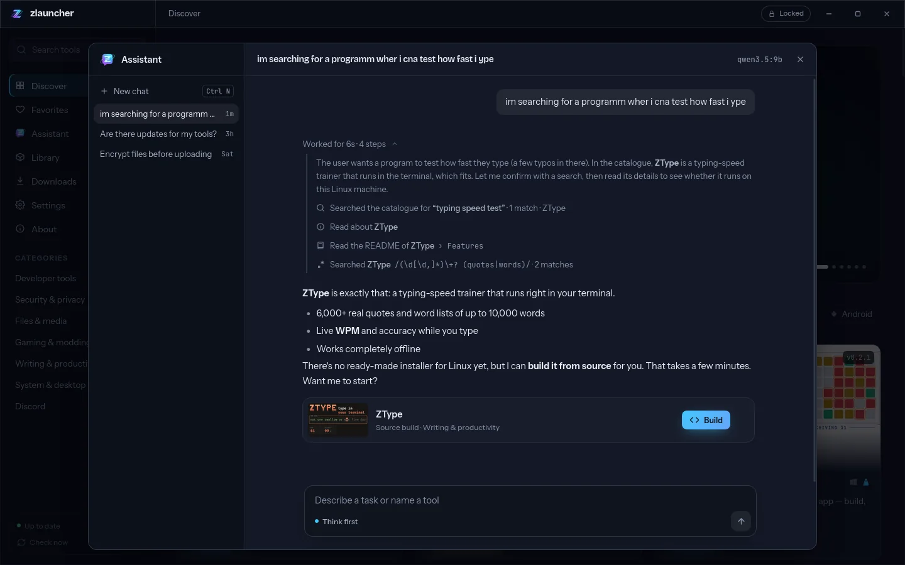

<div align="center">


# ZLauncher

**Every ZSync tool. One launcher.**

Browse the whole [zsync.eu](https://zsync.eu/) catalogue, install any tool with one click (the right file for your system, installed the way your system expects) and keep everything up to date. Or just ask the built-in assistant for what you need, and talk to the developer in an end-to-end encrypted chat.

[Homepage & downloads](https://zsync.eu/zlauncher/) · [All ZSync tools](https://zsync.eu/) · Windows · Linux · macOS · GPL-3.0


</div>

## What it does

- **The whole catalogue.** Every tool from zsync.eu, live from the site: search, filter by system and category, favorites, promo videos.
- **Finds the right download.** Each tool's homepage, release manifests, checksum lists and GitHub releases are read to find its installers, and the one for your system and processor is picked.
- **Installs properly.**
  - Windows: the tool's own setup runs silently, or its `.msi`.
  - macOS: the `.dmg` is opened and the app copied to Applications.
  - Linux: a native `.deb` or `.rpm` where the distro takes it; on Arch and friends, a real pacman package converted from the `.deb`; AppImages everywhere. Menu entries and optional desktop shortcuts come with it.
- **Updates.** New versions show up in the Library with their release notes. You can update one tool or all of them, and get notifications.
- **Checked downloads.** Downloads are resumable and checked against SHA-256 checksums before anything is installed.
- **Finds existing installs.** Tools installed before by hand are found in the system's package database, registry or Applications folder.
- **Build from source.** Tauri tools can be cloned from GitHub and built locally, with a check of what the system needs first.
- **Updates itself.** The launcher's own updates are downloaded in the background and installed on restart. They are signed, and the signature is checked first.


## The assistant

Describe what you need ("something to test how fast I type", "are there updates for my tools?") and the assistant finds the right tool, explains it and does the rest.

- **Searches the catalogue** in your own words, typos included, and answers with cards for the tools it means.
- **Acts for you:** installs, downloads, builds from source, updates one tool or everything, opens a tool, or uninstalls it after you confirm.
- **Reads the source:** a tool's GitHub README (outline first, then the section it needs), regular-expression search inside it, and the repository's stars, license, releases and issues.
- **Knows your system** (OS, processor, Linux install format, what's installed, what has updates) and knows ZSync and its developer.
- **Thinks out loud** with models that reason: the thinking and every tool call stream into the chat as they happen. Thinking can be turned off.
- **Your model, your choice:** [Ollama](https://ollama.com/) by default, fully local: the chat never leaves your computer. Or OpenAI, Anthropic, Gemini, or any OpenAI-compatible server (LM Studio, llama.cpp, …) with your own key. Keys are stored only on your computer and sent only to that provider.



## Talk to TheZ

The launcher has a direct line to the developer built in: [TalkToZ](https://zsync.eu/ttz/) chats, end-to-end encrypted with the same NaCl boxes (X25519 + XSalsa20-Poly1305) as the website.

- **Anonymous** chats need no account. Each one has its own key pair and access token, kept in the launcher's database (not in a browser that can be cleared), so they stay readable and can't be linked to each other. An optional name, encrypted too, replaces "Anonymous".
- **Signed in** through the browser: Discord or Google on the website, a confirmation, then a one-time code back to the launcher on `127.0.0.1`, exchanged with a PKCE verifier. The launcher keeps its own token; signing out revokes it.
- **Files** (pictures, videos, zips, PDFs, text and code, up to 100 MB) are encrypted in chunks with a random key per file (XSalsa20-Poly1305). The key, name and type travel inside the sealed message, so the server stores only ciphertext under random names.
- Received files are never trusted or run. `src-tauri/src/ttz_files.rs` cleans names, allows only listed kinds and checks the real content, on both ends. Pictures are decoded in Rust and re-encoded for display, so the web view never sees the sender's bytes; zips and videos can only be saved, and saved files carry the system's downloaded-from-the-internet mark.
- **Replies** come to you: while a chat is open the launcher checks every minute (every few minutes from the tray). With the launcher in front you get a notice inside it; otherwise a system notification that never shows the subject or the message.
- **Formatting** matches the website: the same Markdown, formatting bar, preview and shortcuts (`src/components/ChatMarkdown.tsx` is a port of the site's parser).
- **Edits and deletes** reach the other side by themselves. A deleted message is wiped from the server, with its files.
- Keys and tokens stay in the Rust side (`src-tauri/src/ttz.rs`); the web view only sees decrypted text and opaque ids, and can't name a path to read: the file picker runs in Rust. The server API is `ttz/api/app.php` on the website.
- The assistant can read, search and draft in these chats if the user turns that on (off by default, because what it reads goes to the AI provider). There is no tool that sends: a draft only goes out when the user presses the button on its card, so text planted in a chat can't make it write to anyone. Decrypted chats stay out of the saved assistant conversation.
- TheHolyOneZ's admin tools stay on the website. The launcher has no admin mode and no admin API.

## Install

Download it from **[zsync.eu/zlauncher](https://zsync.eu/zlauncher/#download)**: an `.exe` or `.msi` for Windows, an AppImage, `.deb` or `.rpm` for Linux, a `.dmg` for macOS (Apple Silicon or Intel).

## Building

You need Node 20+, pnpm, stable Rust and [Tauri's system dependencies](https://v2.tauri.app/start/prerequisites/). On Linux the promo videos also need the GStreamer plugins (`gst-plugins-good`, `gst-libav`).

```sh
pnpm install
pnpm dev            # run the launcher in development mode
pnpm build          # build installers for this system
pnpm typecheck      # TypeScript + the CSS rules check
pnpm test           # Rust tests
pnpm lint:rs        # clippy, warnings as errors
```

### Layout

| Path | What's in it |
|---|---|
| `apps/desktop` | The Tauri v2 app: React 19 + Tailwind 4 UI in `src/`, the Rust side in `src-tauri/` (the assistant is `src-tauri/src/assistant.rs`, Talk to TheZ is `ttz.rs` and `ttz_files.rs`) |
| `crates/zl-catalog` | The tool list (`projects.php`) and promo videos |
| `crates/zl-crawler` | Finds each tool's release files on its homepage (overrides in `overrides.toml`) |
| `crates/zl-download` | Resumable downloads with SHA-256 checks |
| `crates/zl-install` | Installing, updating, launching and removing, per system; detection of existing installs |
| `crates/zl-build` | Building a tool from its GitHub source |
| `crates/zl-store` | The local SQLite database |

## Releasing

The **Release ZLauncher** workflow (Actions, started by hand) builds every installer plus the signed update files and puts them into a draft release. They are published on [zsync.eu/zlauncher](https://zsync.eu/zlauncher/), and installed launchers update themselves from there.

Before a release, raise the version (root `Cargo.toml`, `package.json`, `apps/desktop/package.json`, `tauri.conf.json`) and add its section to [CHANGELOG.md](CHANGELOG.md). That section becomes the release notes; its first paragraph is the update notice inside the launcher.

It needs these repository secrets:

| Secret | What it is |
|---|---|
| `TAURI_SIGNING_PRIVATE_KEY` | The updater signing key; its public half is in `tauri.conf.json`. |
| `TAURI_SIGNING_PRIVATE_KEY_PASSWORD` | The key's password. |
| `ZL_GITHUB_CLIENT_ID` | Optional: a GitHub OAuth app's client ID for "Sign in with GitHub". |

## License

ZLauncher is free software: GNU General Public License v3.0 or later, © 2026 [TheHolyOneZ](https://github.com/TheHolyOneZ). See [LICENSE](LICENSE). The Linux install engine is based on [ZLynstall](https://zsync.eu/zlynstall/). Each tool the launcher installs has its own license.
